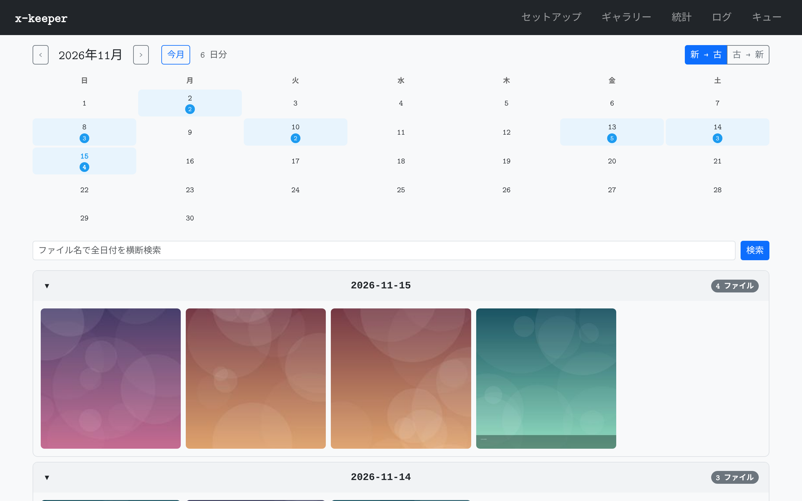
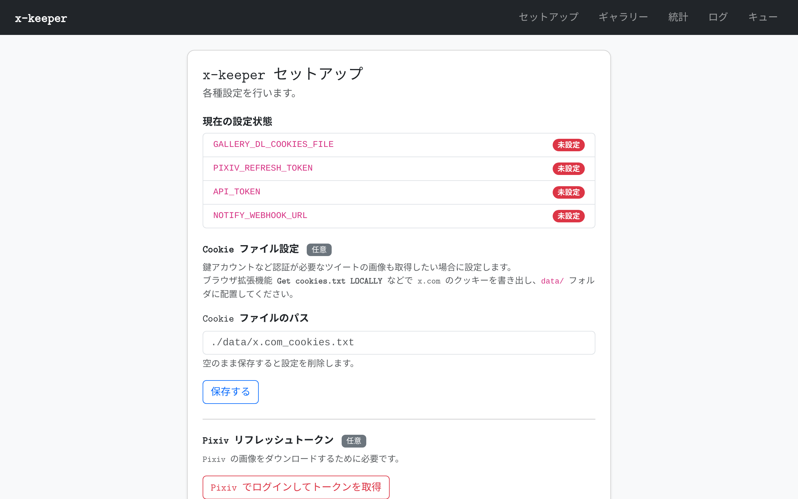
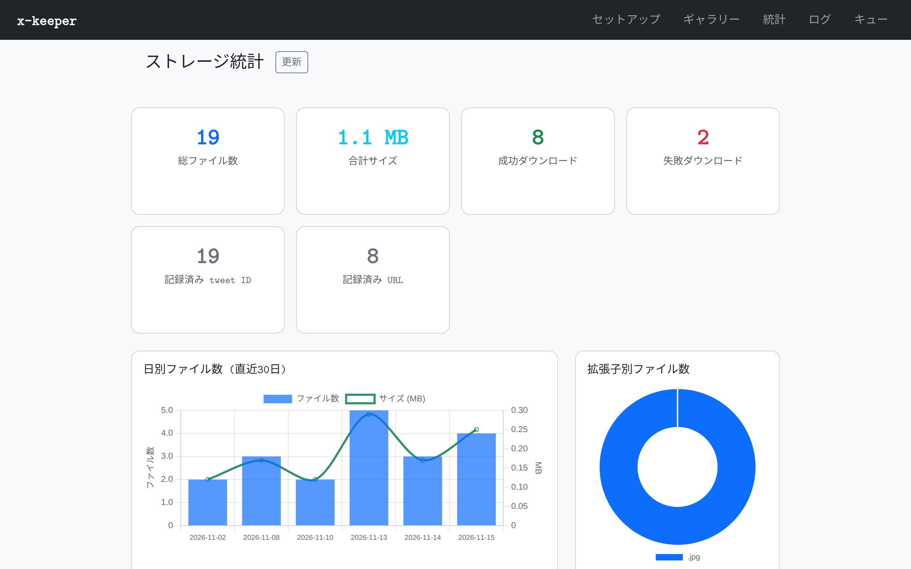
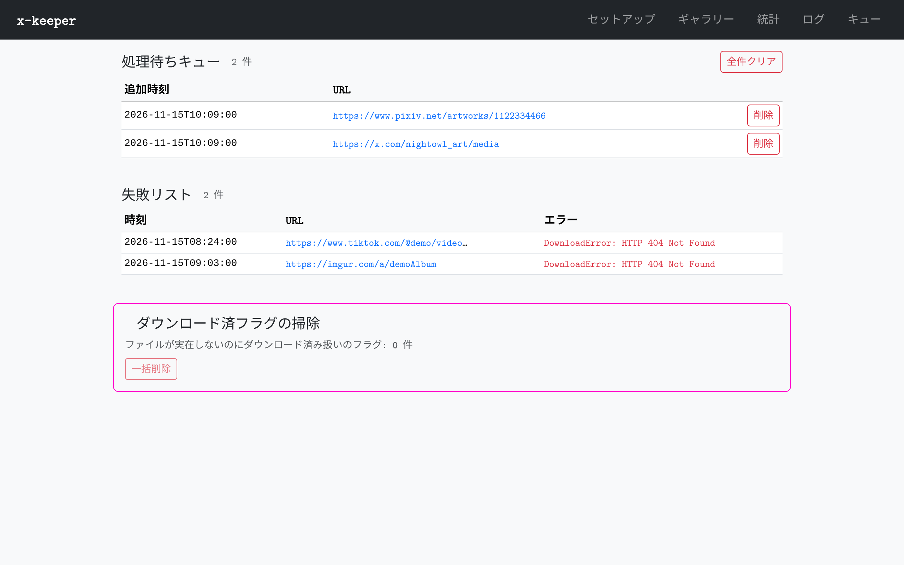
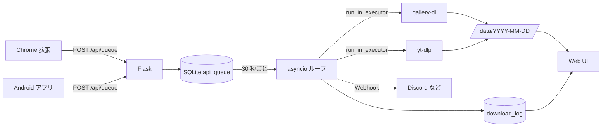

<p align="center">
  
</p>

<h1 align="center">x-keeper</h1>

X / Pixiv / Imgur / YouTube / TikTok / NicoNico のメディアを、自分のサーバーに貯めていくダウンローダーだよ。

Chrome 拡張や Android アプリから URL を投げると、サーバー側の `gallery-dl` と `yt-dlp` が取ってきて、`data/2026-11-15/` みたいな日付フォルダに放り込む。ブラウザを開けば、取れたものがカレンダーとサムネイルで並んでる。Twitter API キーも Discord Bot も要らない。全部ローカルで完結する。



[](LICENSE)


[](https://github.com/solidlime/x-keeper/actions/workflows/docker-build.yml)

**Contents**

- [クイックスタート](#クイックスタート)
- [できること](#できること)
- [対応サービス](#対応サービス)
- [インストール](#インストール)
  - [Docker (推奨)](#docker-推奨)
  - [ローカル実行](#ローカル実行)
  - [Chrome 拡張](#chrome-拡張)
  - [Android アプリ](#android-アプリ)
- [設定](#設定)
- [Web UI](#web-ui)
  - [セットアップ](#セットアップ)
  - [ギャラリー](#ギャラリー)
  - [統計](#統計)
  - [ログ](#ログ)
  - [キュー](#キュー)
- [HTTP API](#http-api)
- [しくみ](#しくみ)
- [ディレクトリ構成](#ディレクトリ構成)
- [開発](#開発)
- [困ったときは](#困ったときは)
- [プライバシー](#プライバシー)
- [ライセンス](#ライセンス)
- [Appendix A: 環境変数](#appendix-a-環境変数)
- [Appendix B: エンドポイント一覧](#appendix-b-エンドポイント一覧)

## クイックスタート

Docker と docker compose が入っていれば、これだけで動く。Python も gallery-dl も自分で入れる必要はない。

```bash
git clone https://github.com/solidlime/x-keeper.git
cd x-keeper
touch .env
docker compose up -d
```

ブラウザで `http://localhost:8989` を開く。はじめての起動ではセットアップ画面が出る。鍵アカウントの画像を取るなら Cookie を、Pixiv を使うならリフレッシュトークンを入れて、「保存する」を押す。空のままでも X の公開アカウントは取れる。

```bash
docker compose logs -f      # 動いてるか見たいとき
docker compose down         # 止めるとき
```

保存先を NAS にしたいときは、`docker-compose.yml` の `volumes` の左側を書き換える。右側の `/data` は変えない。

```yaml
volumes:
  - ./.env:/app/.env
  - /volume1/docker/x-keeper/data:/data
```

## できること

- URL を一本投げれば、あとはサーバーが取ってくる。X のツイート、ユーザーのメディアページ、Pixiv の作品、Imgur のアルバム、YouTube・TikTok・NicoNico の動画を、同じ URL 欄から受け付ける
- 同じものは二度取らない。ツイート ID と URL の両方で履歴を持ち、ファイルを消してからでも再取得しない
- 取れなかった URL はキューに残り、1分後・5分後・15分後にサーバーが自動で再挑戦する（通算3回）。画面から手で押すこともできる
- 月カレンダーに日付ごとの件数が出て、日をクリックするとサムネイルが開く。ファイル名での横断検索も付いてる
- 合計ファイル数、合計サイズ、日付別の推移、拡張子別の内訳をグラフで見られる。DB と実ファイルの食い違いもそこから洗い出せる
- `NOTIFY_WEBHOOK_URL` を入れておくと、成功と失敗が JSON で POST される
- `API_TOKEN` を設定すると `/api/*` に認証がかかる。未設定なら素通しのまま

## 対応サービス

| サービス | 取得エンジン | 受け付ける URL |
|---|---|---|
| X (Twitter) | gallery-dl | `/user/status/123...`、`/user/media` |
| Pixiv | gallery-dl | `pixiv.net/artworks/123...` |
| Imgur | gallery-dl | `imgur.com/...`、`i.imgur.com/...` |
| YouTube | yt-dlp | `watch?v=...`、`shorts/...`、`youtu.be/...` |
| TikTok | yt-dlp | `@user/video/123...`、`t/...` |
| NicoNico | yt-dlp | `nicovideo.jp/watch/...` |

URL の判定は `src/patterns.py` に集約してある。サイトを増やすときは、ここの正規表現と受け付けたい URL を足すだけで済む。

## インストール

### Docker (推奨)

上のクイックスタートが全部。GHCR に `ghcr.io/solidlime/x-keeper:latest` が上がってるから、自分でビルドしたくなければ `docker-compose.yml` の `build:` を消してもいい。

### ローカル実行

Python 3.12 と `gallery-dl` / `yt-dlp` が要る。

```bash
python -m venv .venv
source .venv/bin/activate          # Windows: .venv\Scripts\activate
pip install -r requirements.txt
touch .env
python -m src.main
```

`SAVE_PATH` を渡せば保存先を変えられる。

```bash
SAVE_PATH=/mnt/media/x-keeper python -m src.main
```

### Chrome 拡張

`client/chrome_extension/` が Manifest V3 の拡張で、いまのバージョンは 1.5.1。ポップアップに URL を貼るか、ページを右クリックすれば、その URL がサーバーのキューに入る。

配布用の ZIP は [GitHub Releases](https://github.com/solidlime/x-keeper/releases) の Assets に `x-keeper-chrome-ext.zip` として置いてある。解凍してから `chrome://extensions` を開き、右上の「デベロッパー モード」を入れて「パッケージ化されていない拡張機能を読み込む」で解凍先を選ぶ。ソースから動かすなら `client/chrome_extension/` をそのまま選べばいい。

読み込んだら、ツールバーのアイコンを開いてサーバー URL (`http://localhost:8989`) を入れて保存する。API トークンを設定しているなら、同じ画面のトークン欄にも入れる。テストボタンを押してバッジがオンラインになれば繋がってる。

アイコンを押すと、送信先の設定、直近の送信履歴、キューに積むボタンが出る。ページを右クリックして「このページを x-keeper に送る」でもいい。1 分ごとに `alarms` でサーバーの履歴を取りに行って、もう落としたページには印が付く。SPA の遷移も `webNavigation` で拾う。

### Android アプリ

`client/flutter_app/` が Flutter 製のクライアント。共有シートから URL を受け取って、サーバーに投げる役目。

```bash
cd client/flutter_app
flutter pub get
flutter build apk --release
```

ビルドした APK は `build/app/outputs/flutter-apk/app-release.apk`。CI (`apk-build.yml`) が `main` とタグ push で自動ビルドして、GitHub Release に添付する。

## 設定

設定は `.env` に置く。セットアップ画面から保存したものも、同じ `.env` に書き戻される。全項目は [Appendix A](#appendix-a-環境変数) にまとめたから、よく触るものだけここに書く。

| 変数 | 既定 | 何のため |
|---|---|---|
| `SAVE_PATH` | `./data` | メディアの保存先。日付フォルダはこの下にできる |
| `WEB_SETUP_PORT` | `8989` | Web UI のポート |
| `GALLERY_DL_COOKIES_FILE` | (なし) | 鍵アカを取るときの Netscape 形式 Cookie |
| `PIXIV_REFRESH_TOKEN` | (なし) | Pixiv 用。画面のボタンから OAuth で取れる |
| `API_TOKEN` | (なし) | 設定すると `/api/*` が認証必須になる |
| `NOTIFY_WEBHOOK_URL` | (なし) | 完了・失敗を POST する先 |
| `RETRY_POLL_INTERVAL` | `30` | キューのポーリング間隔 (秒) |
| `GALLERY_THUMB_COUNT` | `50` | 初期表示で何枚ぶんの日付を開くか |

Cookie はブラウザ拡張の "Get cookies.txt LOCALLY" あたりで `x.com` のものを書き出して、`data/x.com_cookies.txt` に置くのが手軽だよ。

## Web UI

画面は5つ。どれも同じナビから移動できる。

### セットアップ



Cookie・Pixiv トークン・API トークン・Webhook の状態が「設定済み / 未設定」で並ぶ。入力して保存すると `.env` に書かれ、空にして保存すればその項目は消える。

### ギャラリー

月カレンダー、日付ごとのアコーディオン、ファイル名の横断検索。並び順は「新→古 / 古→新」で切り替えられる。サムネイルは `Pillow` でその場で縮小生成していて、元ファイルをクリックすれば等倍で開く。

### 統計



合計ファイル数・合計サイズ・日付別のファイル数推移・拡張子別の内訳。DB のログ件数と実ファイルの数を突き合わせて出すから、帳尻が合ってるかはここで分かる。

### ログ

直近 100 件のダウンロード履歴。成功・失敗・ファイル数・エラー本文。

### キュー



処理待ちの URL、失敗した URL とそのエラー、ダウンロード済みフラグが残っているのにファイルが無い件数。URL 単位で消せるし、キューごと空にもできる。

## HTTP API

拡張もアプリもこの API しか使ってない。

```bash
curl -X POST http://localhost:8989/api/queue \
  -H 'Content-Type: application/json' \
  -H 'X-API-Token: YOUR_TOKEN' \
  -d '{"url": "https://x.com/user/status/1800000000000000001"}'
```

```json
{"ok": true, "queued": 1}
```

`API_TOKEN` を設定した場合、`/api/health` と OPTIONS プリフライト以外は `X-API-Token` か `Authorization: Bearer` が要る。ブラウザから使うぶんにはセッションで通る。全エンドポイントは [Appendix B](#appendix-b-エンドポイント一覧) に置いてある。

## しくみ



各ダウンロードは `run_in_executor` でスレッドに逃がしてあるから、subprocess が詰まってもイベントループは止まらない。キューは SQLite にあるから、コンテナを落として上げ直しても積んだ URL は消えない。同じ URL を二度積むとキー衝突で弾かれる。

## ディレクトリ構成

```text
src/
  main.py             エントリーポイント。asyncio ループと Flask の起動
  image_downloader.py gallery-dl / yt-dlp のラッパー
  patterns.py         URL 判定の正規表現を一箇所に
  log_store.py        SQLite (ログ・キュー・重複防止・統計)
  notify.py           Webhook 通知
  config.py           pydantic-settings による設定
  web/
    __init__.py       Flask app と Blueprint 登録
    routes/           setup / gallery / api / media / admin
    templates.py      全 HTML (文字列テンプレート)
    auth.py           API トークン認証
client/
  chrome_extension/   Manifest V3 拡張
  flutter_app/        Android アプリ
tests/                pytest 146 件
```

HTML は Jinja テンプレートファイルじゃなくて `src/web/templates.py` の文字列。ファイルが一つ増えるより、Python の中で完結したほうが扱いやすいからこうしてある。

## 開発

```bash
pytest -q                    # 146 件
pytest tests/test_api.py -q  # ファイル指定
```

テストは `test_patterns` / `test_log_store` / `test_api` / `test_auth` / `test_notify` / `test_image_downloader` の6本。API は Flask のテストクライアントで叩いてるから、サーバーを起動しなくても走る。

CI は2本。`docker-build.yml` が `main` への push で GHCR にイメージを上げ、`apk-build.yml` が APK をビルドして Release に添付する。

実装で踏みやすいのは次の4つ。

- ダウンロードは必ず `await loop.run_in_executor(None, ...)` 経由で呼ぶ。直接呼ぶとイベントループが止まる
- `_download_one()` は `(files, rc_ok)` を返す。`files, rc_ok = ...` で受ける
- `log_store.py` のローカル変数に `queue` を使わない。`import queue` とぶつかる
- 新しい URL パターンは `src/patterns.py` に足す。各所で正規表現を書き直さない

## 困ったときは

画像が0枚のままなら、`GALLERY_DL_COOKIES_FILE` のパスがコンテナ内から見えているか確かめる。`docker compose exec x-keeper ls /data/` で見える位置にないと意味がない。

Pixiv だけ失敗するのは、リフレッシュトークンが切れているから。セットアップ画面の「Pixiv でログインしてトークンを取得」を押し直す。

同じ画像が何度も落ちてくるなら、キュー画面の「ダウンロード済みフラグの掃除」で `downloaded_ids` と `downloaded_urls` を見る。DB を消せば全部取り直しになるので、消す前にバックアップ。

ファイルを消したのに再取得されないのは仕様。ファイル名からツイート ID を逆引きして履歴に残している。取り直したいときは `/api/downloaded/id/<tweet_id>` を DELETE する。

ポートが埋まっているときは `WEB_SETUP_PORT` を変える。`docker-compose.yml` の ports も同じ値を見ているから、`.env` だけで効く。

## プライバシー

取ってきたメディアも、ダウンロード履歴も、Cookie も `.env` のトークン類も、このマシンの外には出ていかない。外へ出るのは、`NOTIFY_WEBHOOK_URL` を設定したときの通知だけ。`gallery-dl` と `yt-dlp` が各サイトにアクセスするのは、メディアを取りに行く以上避けられない。

`API_TOKEN` を設定しないと `/api/*` は誰でも叩ける。LAN の外に公開するなら必ず設定して、リバースプロキシの後ろに置いてちょうだい。

## ライセンス

MIT。[LICENSE](LICENSE) を見て。

## Appendix A: 環境変数

| 変数 | 既定値 | 説明 |
|---|---|---|
| `SAVE_PATH` | `./data` | メディア保存先。日付フォルダ (`YYYY-MM-DD`) はこの下 |
| `WEB_SETUP_PORT` | `8989` | Web サーバーの待ち受けポート |
| `GALLERY_THUMB_COUNT` | `50` | ギャラリー初期表示で開く日付フォルダ数 |
| `RETRY_POLL_INTERVAL` | `30` | API キューのポーリング間隔 (秒) |
| `GALLERY_DL_COOKIES_FILE` | (なし) | gallery-dl に渡す Netscape 形式 Cookie のパス |
| `PIXIV_REFRESH_TOKEN` | (なし) | Pixiv の OAuth リフレッシュトークン |
| `API_TOKEN` | (なし) | 設定すると `/api/*` が認証必須。未設定なら素通し |
| `NOTIFY_WEBHOOK_URL` | (なし) | 完了・失敗を POST する Webhook |
| `LOG_LEVEL` | `INFO` | `DEBUG` / `INFO` / `WARNING` / `ERROR` |
| `DOCKER_IMAGE` | `ghcr.io/solidlime/x-keeper:latest` | compose が使うイメージ |

`.env.example` は古い項目（Discord など）が残っているので、実際に効くのは上の表と `src/config.py` のほう。

## Appendix B: エンドポイント一覧

### キューと履歴

| メソッド | パス | 説明 |
|---|---|---|
| `POST` | `/api/queue` | URL を積む |
| `GET` | `/api/queue/status` | キューの状態 |
| `DELETE` | `/api/queue/item` | URL を1件消す |
| `POST` | `/api/queue/clear` | キューを空にする |
| `GET` | `/api/logs/recent` | 直近のログ |
| `GET` | `/api/history/count` | 履歴の件数 |
| `GET` | `/api/history/ids` | ダウンロード済みツイート ID |
| `GET` | `/api/history/urls/count` | ダウンロード済み URL の件数 |
| `GET` | `/api/history/urls` | ダウンロード済み URL |
| `GET` | `/api/history/export` | 履歴をエクスポート |
| `POST` | `/api/history/import` | 履歴をインポート |
| `GET` | `/api/history/stream` | 進捗のストリーム |

### 個別の削除と整合性

| メソッド | パス | 説明 |
|---|---|---|
| `DELETE` | `/api/downloaded/id/<tweet_id>` | ツイート ID のフラグを消す |
| `DELETE` | `/api/downloaded/url` | URL のフラグを消す |
| `GET` | `/api/downloaded/orphans` | ファイルが無いのに残ってるフラグ |
| `DELETE` | `/api/downloaded/orphans` | 孤児フラグを掃除 |
| `GET` | `/api/storage/consistency` | DB と実ファイルの突き合わせ |
| `GET` | `/api/storage/orphans` | 孤児ファイル |
| `POST` | `/api/storage/reindex` | 再インデックス |

### ギャラリーとメディア

| メソッド | パス | 説明 |
|---|---|---|
| `GET` | `/api/gallery/search` | ファイル名で検索 |
| `GET` | `/api/gallery/calendar` | カレンダー用の日付別件数 |
| `GET` | `/api/stats` | ストレージ統計 |
| `GET` | `/media/<path>` | メディア本体 |
| `GET` | `/thumb/<path>` | サムネイル |
| `POST` | `/delete-media` | メディアを削除 |

### 動作確認

| メソッド | パス | 説明 |
|---|---|---|
| `GET` | `/api/health` | `{"status": "ok", "version": "1.0"}`。認証不要 |
| `POST` | `/api/update` | 設定の更新 |
